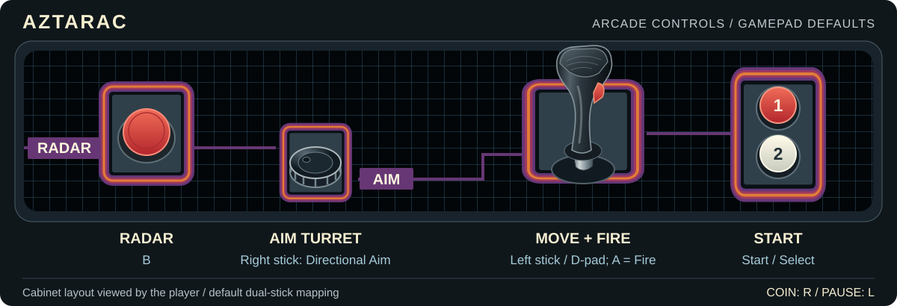

# Aztarac for MiSTer FPGA

**Aztarac** is a legendary collector's holy grail: one of the most elusive
and distinctive color-vector arcade games ever released. Created by
**Tim Stryker** for **Centuri in 1983**, it pairs dazzling geometric battles
with an unmistakable transparent plexiglas dome. Centuri's only color-vector
release is an ambitious game that far too few players ever had a chance to
discover. [The story of this arcade holy grail](https://arcadeblogger.com/2017/01/20/centuri-aztarac-finding-the-holy-arcade-grail/)

Move your ship with the joystick, turn its gun independently with the spinner,
and use the sweeping radar to intercept enemy formations before they reach
your starbase. The campaign advances through the signs of the zodiac, with
increasingly dangerous attackers and changing starbase shapes. Losing your
ship lets you return to the fight; losing the last section of your starbase
ends the game.

Its inventive combination of independent movement and 360-degree aiming,
a radar view of the wider battlefield, and collectible power and energy
pods gives the action surprising depth. You are defending a position across
a much larger universe, not simply clearing a single screen.
[Stryker's own restored cabinet](https://arcadeblogger.com/2017/12/08/tim-strykers-aztarac-the-final-chapter/).

## Support the Project

Hey, Videodr0me here! If you enjoy this core, please consider supporting my
work and future updates:
[](https://buymeacoffee.com/Videodr0me)

---

## Original Hardware

| Subsystem | Original Hardware | FPGA Implementation |
|---|---|---|
| **Main CPU** | Motorola 68000 at **8 MHz** | FX68K, with the original 8 MHz CPU rate  |
| **Sound CPU** | Zilog Z80 at **2 MHz**, handling sound commands independently of the main CPU | Spectrum T80 with [SCF/CCF flag fixes](rtl/cpu/t80/README.md), at the original 2 MHz rate |
| **Sound Generators** | Four AY-3-8910 chips at **2 MHz** each, providing twelve tone channels plus noise | Four JT49 implementations, with filtering and mono audio on both output channels |
| **Vector Display** | Custom display-list hardware driving a **Wells-Gardner 19K6401** color XY monitor; two bits per RGB channel and eight-bit intensity | A 125 MHz vector renderer, with up to **1440 x 1080** native drawing resolution and adjustable CRT effects |
| **Cabinet** | Transparent plexiglas dome, printed labels and surrounding cabinet finish | Videodr0me's completely new artwork with adjustable brightness, plus a Labels Only option |
| **Controls** | Proportional encoder joystick with a fire trigger, separate turret track wheel and radar button | Dual analog sticks, spinner, mouse, D-pad and remappable buttons |
| **Nonvolatile Memory** | X2212, **256 x 4 bits**, retaining operator settings and champion records | Complete NVRAM saving and loading through MiSTer |

High-score saving preserves the game's **three All Time Champions** entries:
Gold, Silver and Bronze, with their scores and initials.

---

## Renderer Features

- **HD vectors:** 1080p and 720p rendering, with optional 120 Hz at 720p.
- **CRT effects:** Adjustable line thickness, dwell size (Dot Scale), bloom,
  halo, phosphor trails, color effects and slot mask.
- **Video profiles:** Five ready-to-use looks and two independent custom slots.
- **CRT output:** 240p, 480i and 480p, including Direct Video.
- **Plexidome artwork:** Videodr0me's new design, loaded automatically, with
  adjustable brightness and full artwork, Labels Only or Off modes.
- **Rotation:** Normal, clockwise and counterclockwise views with matching
  artwork for physically rotated monitors.

---

## Controls

The original cabinet uses a proportional directional joystick to move the
ship, with **Fire** on its trigger. A **track wheel (spinner)** to its left turns
the turret independently, while a separate **Radar** button brings up the
scanner. This lets you move in one direction while firing in another.



The core defaults to **dual-stick controls with Directional Aim**: move with
the left stick and point the right stick where you want to shoot. Releasing
the right stick holds the last aiming direction. These are the supplied
gamepad defaults; MiSTer's input mapping also supports remapped keyboard
controls.

| Function | Default |
|---|---|
| Move | Left analog stick or D-pad |
| Aim turret | Right analog stick; X / Y are optional turn buttons |
| Fire | A or left mouse button |
| Radar / scanner | B or right mouse button |
| Start 1 | Start |
| Start 2 | Select |
| Coin | R |
| Pause | L |

The game supports two alternating players. Insert two credits and press
**Start 2** for a two-player game.

In **Controls**, set **Aim with** to **Right Stick** or **Spinner / Mouse**.
The left stick and D-pad move the ship with either choice. Mouse buttons
can always fire and show radar.

| Right Stick Mode | Behavior |
|---|---|
| **Directional Aim (default)** | Point the stick where you want to shoot; release it to hold that angle. |
| **Horizontal Pos** | Left-to-right stick travel covers one full revolution. |
| **Rotation Speed** | Push farther left or right to turn faster; center stops rotation. |

**Sensitivity** is shared by Rotation Speed and Spinner / Mouse. It ranges
from 0.25x to 3x and defaults to 1x. **Direction** reverses Horizontal Pos
and Rotation Speed together; the spinner/mouse remembers its own direction.
Settings that don't apply are greyed out.

Configure both analog sticks in MiSTer's main menu. In **Define Aztarac buttons**,
use the D-pad for the movement directions. **Turret CCW (button)** and
**Turret CW (button)** are optional digital turning controls: assign buttons
or skip them. Existing saved button assignments keep their positions.

### Profile Shortcuts

With the OSD closed, use the two keys immediately to the right of **0** to cycle
profiles. On a US keyboard, **-** selects the previous profile and **=/+**
selects the next. Cycling follows the profile table below, wrapping from
**Custom 2** back to **A Touch of CRT**.

**F6** copies the current profile into **Custom 1**; **F7** copies it into
**Custom 2**. A message confirms the copy, and the current profile stays
selected. Select the custom slot to adjust it, then use **Save Settings**
to retain your choices.

### Cabinet Diagnostics and Operator Setup

From attract mode, choose **System / Cabinet Service Switch** to enter the
original diagnostics. Activate it twice more to reach operator setup.
Sweep the right stick around to highlight a choice (or turn the spinner
if **Aim with** is set to **Spinner / Mouse**),
then press **Fire** to select it;
use the service switch to advance or exit.

Setup includes free play and coinage, difficulty and target play time,
attract sound, the Sagittarius free-game award, and high-score reset.
**Autosave Game Settings** defaults to On. **Save Game Settings** saves
manually; MiSTer's **Save Settings** stores OSD preferences separately.

**Slam/Tilt** activates the cabinet's anti-abuse switch and its **CUT THAT OUT!** message.

---

## Requirements and Installation

- DE10-Nano MiSTer with a **32 MB or larger SDRAM module**.
- `aztarac.zip` matching the ROM parts and checksums in the supplied MRA.
  **Game ROMs are not included.**

Use a matching RBF build with the supplied MRA.

1. Copy the latest `Arcade-Aztarac_*.rbf` from [`releases`](releases/) to `_Arcade/cores/`.
2. Copy [`Aztarac.mra`](releases/Aztarac.mra) to `_Arcade/`.
3. Place `aztarac.zip` in `games/mame/`, then launch the MRA.

Artwork is included in the MRA and loads automatically.

---

## Recommended MiSTer Video Settings

**1080p** gives the highest vector detail. For an HD display, place
this section at the end of `MiSTer.ini`. Empty filter and mask entries let
the core's own CRT effects determine the image.

```ini
[Aztarac]
direct_video=0
video_mode=8   ; 8 = 1080p, 0 = 720p
video_mode_ntsc=
video_mode_pal=
hdr=0
vsync_adjust=0 ; use 1 or 2 for the 720p 120 Hz option
vscale_mode=0
hdmi_limited=0 ; use 1 if your display expects limited RGB range
vfilter_default=
vfilter_vertical_default=
vfilter_scanlines_default=
shmask_default=
shmask_mode_default=0
```

**Note for RetroTINK users:** If you normally leave Direct Video enabled,
override it for this core with **`direct_video=0` and `video_mode=8`** to
give your scaler the highest-quality 1080p source. Direct Video limits the
core's native rendering to 480p/i or 240p. Upscaling that lower-resolution
image to 4K cannot recover the vector detail available from native 1080p.

### CRT and Direct Video Output

For a **15 kHz CRT**, use these video settings in the same section instead:

```ini
[Aztarac]
video_mode=720,240,60
vsync_adjust=0
video_mode_ntsc=
video_mode_pal=
vga_scaler=0
forced_scandoubler=0
```

Under **Video Overlay & Geometry**, **15 kHz Format** selects **480i**
(default) or **240p**. Keep the VGA scaler and forced scandoubler disabled
for native CRT output. For a **31 kHz CRT**, use `video_mode=720,480,60`.

For **Direct Video**, also add `direct_video=1`. The **Direct Video Scan
Rate** menu option selects 15 kHz or 31 kHz; at 15 kHz, choose 480i or 240p
with **15 kHz Format**.

---

## Video Options

### Video Profiles & Effects

| Profile | Description |
|---|---|
| **A Touch of CRT** | Subtle CRT glow. |
| **80s Cruise Control** | Clear vectors and gentle glow. Default. |
| **80s Overdrive** | Brighter lines, sparks and fuller phosphor. |
| **Plasmarac** | Wide halos and lingering light. |
| **Negative Shield** | Dense glow and long trails, with negative colors at every resolution. |
| **Custom 1** | Custom settings initialized from Cruise Control for the current resolution. |
| **Custom 2** | Custom settings initialized from Overdrive for the current resolution. |

Fixed profiles adapt to the output resolution. The two custom slots offer
independent dot size, tone mapping, bloom, halo, decay, color and slot-mask
controls. Saved custom settings take precedence over the initial defaults.

See the [complete profile guide](Profiles/Profiles.md) for every preset's
settings at each resolution and explanations of the individual effects.

### Video Overlay & Geometry

| Option | Description |
|---|---|
| **Overlay** | **On** shows the full plexidome artwork. **Labels Only** shows SCORE, CONDITION, POWER and ENERGY. **Off** disables all additional artwork. |
| **Artwork Brightness** | Adjusts artwork brightness from 10% to 100%. Default: **100%**. |
| **Orientation** | Normal, 90 CCW or 90 CW. Rotates the picture and artwork for a physically rotated monitor. |
| **120Hz (720p only)** | Enables 120 Hz output on compatible 720p displays. |
| **Direct Video Scan Rate** | Selects 15 kHz or 31 kHz for Direct Video. |
| **15 kHz Format** | Selects 480i or 240p for 15 kHz output. Default: **480i**. |
| **CRT Vertical Offset** | Moves the whole picture, including artwork, at 240p, 480i and 480p. Positive steps move it down and negative steps move it up. The default is **0**. |
| **CRT Horizontal Offset** | Moves the whole picture, including artwork, four pixels per step at 240p, 480i and 480p. Positive steps move it right and negative steps move it left, up to 12 pixels either way. The default is **0**. |

Leave the **Diagnostics** settings at their defaults for normal use.

### System

**Audio Low-Pass** softens the full sound mix, with **Off**, **4 kHz**,
**6 kHz** (default) and **8 kHz** choices. Channel balance is unchanged.

**Pause when OSD open** defaults to Off. **Dim video after 60s** defaults to
On and dims the picture while paused. For game saving, the cabinet service
switch and Slam/Tilt, see
[Cabinet Diagnostics and Operator Setup](#cabinet-diagnostics-and-operator-setup).

---

## Compilation

Open `Aztarac.qpf` in **Quartus Prime Lite 17.0** and run the full compilation
flow, including timing analysis. The generated `Aztarac.rbf` is written to
`output_files/`.

## Credits and Licensing

- **Tim Stryker:** Aztarac's game design, programming, vector graphics and
  sound. The [restoration of his own cabinet](https://arcadeblogger.com/2017/12/08/tim-strykers-aztarac-the-final-chapter/)
  tells the story of the person behind the game.
- **Centuri:** Aztarac's manufacturer grew out of Allied Leisure and became
  known for bringing licensed arcade hits to American players. Aztarac was one
  of its ambitious in-house projects. Centuri built cabinets in its own shop
  in Hialeah, Florida.
  [Centuri interviews](https://www.centuri.net/interview2.htm)
- **Steve Zarzecki and Willie Maybohm:** Centuri's hardware engineering team,
  led by Zarzecki with Maybohm assisting, as recalled by colleague
  [Lee Feuling](https://arcadeblogger.com/2018/05/25/centuri-inc-the-king-of-licenced-arcade-games/).
  **Wells-Gardner** supplied the color-vector monitor and **Wico** the
  encoder joystick and track-wheel assemblies.
- **Preserved technical documentation:** Centuri's
  [service manual](https://www.arcade-museum.com/manuals-videogames/A/Aztarac.pdf),
  [schematics](https://www.arcade-museum.com/manuals-videogames/A/Aztarac-Schematics.pdf)
  and the archived [Wells-Gardner monitor evaluation](https://www.andysarcade.net/pix/Aztarac_WG_Monitor.pdf)
  provide the operating instructions, circuit references, controls, parts
  lists and contemporary display-engineering evidence. Thanks to the
  collectors and archives preserving these records.
- **Tony Temple / The Arcade Blogger, the Stryker family and the restoration
  team:** Game history, interviews, cabinet photographs and restoration
  evidence that helped bring Aztarac back into view.
- **FX68K, T80 and JT49 contributors:** CPU and sound implementations;
  component headers retain their individual credits.
- **Mathis Rosenhauer, David Fish and MAME contributors:** Aztarac emulation
  and hardware research, especially the vector display list format and
  interrupt acknowledgement. See the
  [MAME driver](https://github.com/mamedev/mame/blob/master/src/mame/alliedleisure/aztarac.cpp).
- **Sorgelig and the MiSTer community:** Platform and framework.
- **Videodr0me:** FPGA core integration, vector presentation and completely
  new plexidome artwork, including the reflective finish and labels.

See [LICENSE](LICENSE), [licenses/](licenses/), and the source headers.
Game ROMs and third-party components retain their respective owners' rights.
